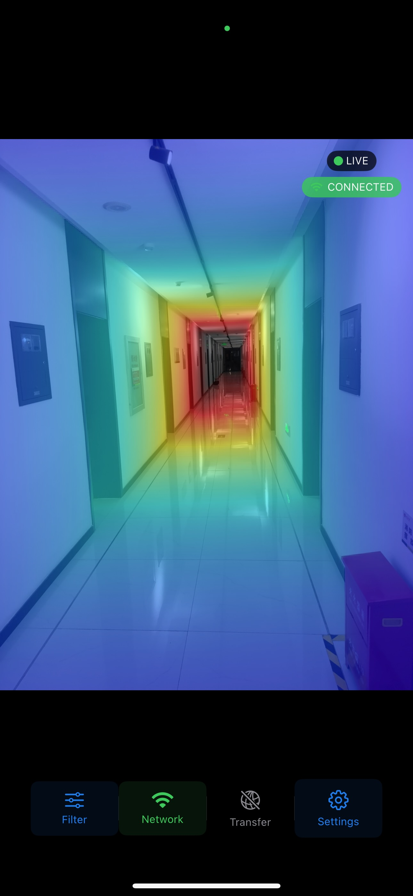
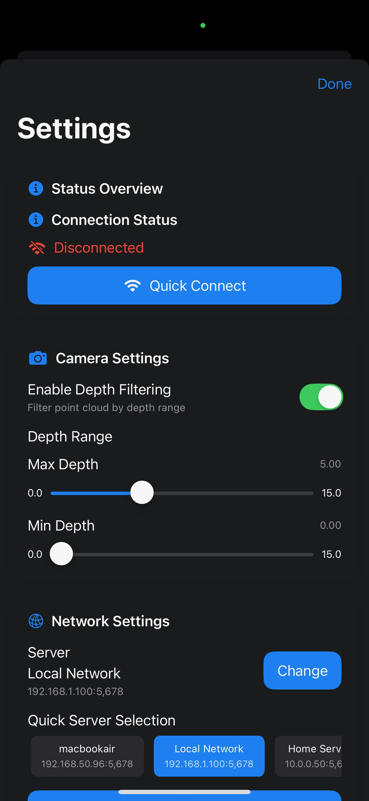
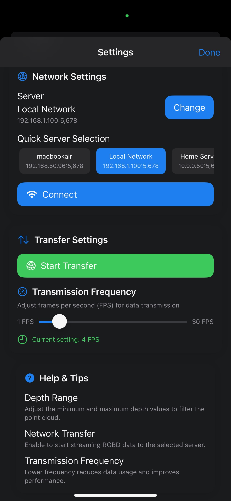

# iLiDAR — Real-Time iPhone LiDAR + RGB-D Streaming

iLiDAR is an iOS application that transforms your iPhone into a powerful multi-modal visual sensor by leveraging the built-in LiDAR scanner and RGB camera. The app enables real-time streaming of both depth maps and color images to a PC server for data collection and analysis.

[Project page](https://galaxywalk.github.io/project/ilidar/) · [Full tutorial](full_tutorial.md)

## App Overview

iLiDAR provides an intuitive interface for capturing and streaming LiDAR depth data alongside RGB video. The app features:

- **Real-time Depth Mapping**: Captures high-resolution depth data using iPhone's LiDAR scanner
- **Synchronized RGB Video**: Records color images simultaneously with depth data
- **Network Streaming**: Streams data in real-time to a PC server over Wi-Fi
- **Configurable Settings**: Adjustable transmission frequency and depth filtering
- **Server Management**: Built-in IP address management for easy server connection

### App Screenshots

<div align="center">
  
  
  
  <p><em>Main interface, network settings, and advanced configuration</em></p>
</div>

## Quick Start

### Device Compatibility

Only specific iPhone models equipped with LiDAR are supported. Ensure your device is listed in the [supported devices list](https://support.apple.com/en-us/102468#:~:text=Use%20the%20Measure%20app%20with%20a%20Pro%20device). Generally, all iPhone Pro models from iPhone 12 Pro and later, as well as the latest iPad Pro models, are supported.

### Building and Installing the App

1. Open `iLiDAR.xcworkspace` in Xcode (macOS required)
2. Configure your development account and handle any permission requests
3. Connect your iPhone (Pro model) via USB or wirelessly
4. Build and transfer the app to your iPhone

**Important**: When prompted with "Allow APP to use camera" or "Allow APP to find local network devices?", select "Allow."

### Setting Up the Server

1. Ensure both your iPhone and PC are connected to the same Wi-Fi network
2. From the repository root, run:

```bash
cd Server
conda create -n ilidar python=3.10 -y
conda activate ilidar
pip install -r requirements.txt
python ios_driver.py
```

The server will listen on port `5678` and create an `uploads` folder to store incoming data. You should see:

```bash
[*] Server listening on 0.0.0.0:5678
```

### Streaming Data

1. Open the iLiDAR app on your iPhone
2. Enter your PC's IP address (e.g., `192.168.1.10`)
3. Tap "Connect" to establish the connection
4. Tap "Enable Network Transfer" to begin streaming

If successful, you'll see logs like:

```bash
[>] Received Packet - Filename: 20241208_223229_20241208_223232_76_frame000316.jpg, Type: JPG, Seq: 55, IsLast: False, Size: 1024 bytes
```

**Note**: The app cannot run on the iOS Simulator as it requires the LiDAR API, which is not available in the simulator.

### Analyzing Received Data

Use the provided scripts in `Server/read_depth_data.py` to analyze the received depth and RGB data. Sample files are available in `Server/example_data/` for testing.

## Recent Updates

We release components immediately after validation to make polished code and reproducible experiments available as soon as possible. Recent updates include:

- [x] Add Homepage picture
- [x] Enhanced local processing scripts
- [x] Local IP address management
- [x] Improved network status indicators
- [x] Released iLiDAR app
- [x] Updated network support
- [x] Enhanced UI support

## Customization

For detailed modification instructions, refer to the [Full Tutorial](full_tutorial.md).

### File Naming Convention

The system follows a structured naming convention:

- **Event Timestamp**: Each transfer session is marked with `yyyyMMdd_HHmmss`
- **Frame Timestamp**: Individual frames use `yyyyMMdd_HHmmss_SS` with sequential IDs
- **File Formats**:
  - RGB images: `[event_timestamp]_[frame_timestamp]_frame%08d.jpg`. It will recount when the count reach 99,999,999.
  - Depth data: `[event_timestamp]_[frame_timestamp]_frame%08d.bin`. It will recount when the count reach 99,999,999.
  - Camera parameters: `[event_timestamp].csv`.

### Performance Tuning

- **Image Compression**: RGB images are compressed to 0.4 quality by default. Modify `DataStorage.compressionQuality` based on your network conditions.
- **Frame Rate**: Default transmission rate is 4 FPS; you can adjust it in Settings.

### Stream format and receiver settings

The app connects to the Windows PC's IPv4 address and TCP port `5678`. Set the address in the app's network settings; `Server/ios_driver.py` binds to `0.0.0.0:5678`. Allow Python through Windows Defender Firewall on private networks and keep both devices on the same Wi-Fi network. After a connection drops, the app disables transfer; reconnect from Settings before resuming. Automatic retry is not implemented.

Each RGB and depth file uses the same frame timestamp and frame number. Files are sent as TCP chunks with a 1-byte UTF-8 filename length, filename, 1-byte type (`1` JPEG, `2` depth binary, `3` CSV), 4-byte big-endian payload length, 4-byte big-endian chunk sequence, 1-byte last-chunk flag, then payload. TCP provides ordered delivery; chunk sequence numbers let the receiver reconstruct each file. The app sends the depth file before its matching JPEG. JPEG quality is `0.4`; depth values are uncompressed Float16 meters in the device's native byte order (little-endian on iPhone), row padding removed. A per-session CSV contains camera intrinsics (`fx,fy,cx,cy`). The transfer frequency defaults to 4 FPS and is adjustable in the app.

Depth width and height are not included in the `.bin` file or current CSV. `Server/read_depth_data.py` currently assumes `320 × 240`; change `depth_width` and `depth_height` there to the actual dimensions selected by the iPhone capture format. The app logs the selected depth format at startup. Each depth file must contain exactly `width × height × 2` bytes. You can inspect a file with:

```python
from pathlib import Path
print(Path("uploads/FRAME.bin").stat().st_size)
```

For example, `153600` bytes corresponds to `320 × 240` Float16 values. If the selected device format differs, use its logged dimensions in `read_depth_data.py`; the receiver cannot reliably infer shape from raw Float16 bytes alone. RGB images are JPEGs and their dimensions should be read from the JPEG itself. Python dependencies are listed in `Server/requirements.txt` (`numpy`, `scipy`, `matplotlib`, and `Pillow`). Frame pairing is by the shared filename, while AVCapture synchronizes RGB and depth at capture time. Confirm selected dimensions and sustained frame rate on a physical iPhone 12 Pro Max.

### AltStore installation

The GitHub Actions IPA is unsigned because the workflow has no signing credentials. AltServer can sign an imported IPA for installation using a free Apple ID, subject to Apple's free provisioning limits: installed apps expire after 7 days and require periodic refresh, with a limit of three active sideloaded apps. Follow AltStore's [Windows installation guide](https://faq.altstore.io/altstore-classic/how-to-install-altstore-windows): install iTunes and iCloud directly from Apple, install and run AltServer as administrator, connect and trust the iPhone, then install AltStore from the AltServer tray menu. To install the downloaded IPA, hold **Shift** while clicking AltServer and choose **Sideload .ipa…**. Keep AltServer running for refreshes; background refresh requires AltServer and a usable connection. This does not provide App Store distribution or a permanent signature. See [AltStore's refresh and app-limit notes](https://faq.altstore.io/altstore-classic/your-altstore).

The bundle identifier is `com.zakariakaddouri.ilidar`. If it is already registered to another developer account, AltStore signing may require changing it to a unique identifier before installation.

## Reference

This project is built upon the [Apple Official Depth Camera Example](https://developer.apple.com/documentation/avfoundation/additional_data_capture/capturing_depth_using_the_lidar_camera).

## License

This project is licensed under the MIT License - see the [LICENSE](LICENSE.txt) file for details.
